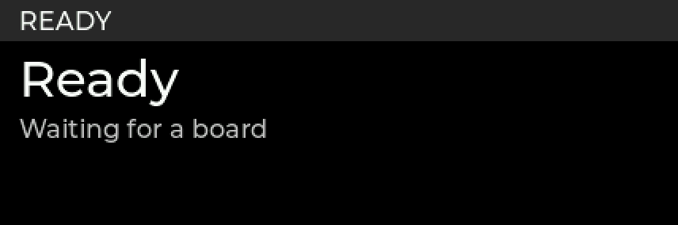
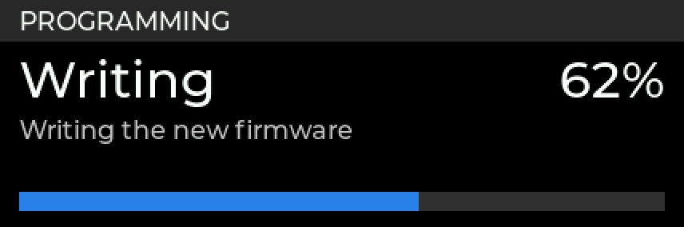
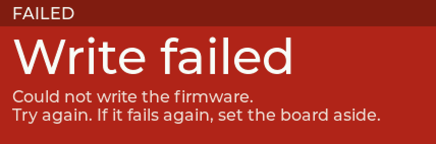
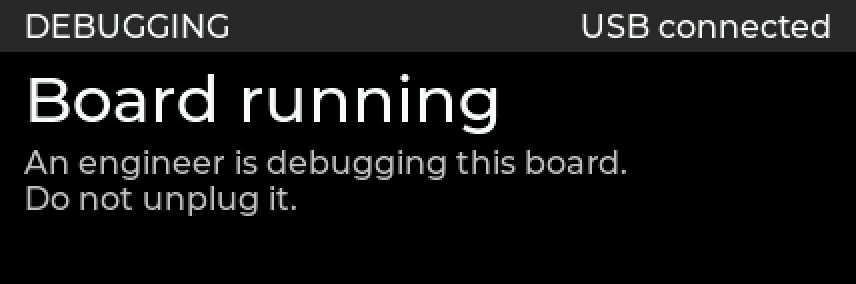

# The screen

The 2.79" LCD (NT279VJ, 428 x 142) shows what the device is doing in plain
English for factory staff, and enough detail for firmware engineers. Other
panels have no UI: the display stays off.

Every screen has the same layout:

- **Header strip**: the activity in capitals (READY, PROGRAMMING, DEBUGGING,
  PASSED, FAILED, ATTENTION), and on the right the link to a computer: "USB
  connected" or "Network connected" (Wi-Fi or cellular).
- **Title**: one or two words, such as *Writing* or *Pass*.
- **Detail**: up to two lines saying what is happening or what to do next.
- **Progress bar and percentage**: only while a step reports progress.

There are four colours. Black means ready, working or debugging. Green means
the run passed. Red means the run failed: the board needs attention. Amber
means the device needs attention, not the board, for example when there is no
job or the log is full. The screen never animates.

## Screens

| Screen | When |
| --- | --- |
|  | Waiting for a board. With a trap armed (see [Agent sessions](agent-sessions.md)), the detail says the board is being watched. |
|  | A run, step by step: *Starting*, *Connecting*, *Erasing*, *Writing*, *Checking*, *Testing*. Writing shows progress as blocks are written. |
|  | The run passed. |
|  | The run failed. The title names the step; the detail says what to do. A script error shows the script's message. |
|  | The device needs attention: no job, a job out of date, a full log, a storage error, or a cancelled run. |
|  | A debugger (GDB through `sidp-agent`) is attached: *Board running*, *Board paused* or *Board not answering*. Shown until it detaches; the previous screen then returns. |

`docs/en/images/ui` has every screen.

## Programming speed and debugging

Drawing never holds up a run or a debug session:

- A screen change only stores the new screen and returns, from any task, with
  no lock shared with LVGL. Progress for each written block is a single
  atomic store.
- A timer in the LVGL task picks the change up within 100 ms and redraws only
  the labels that changed. An unchanged screen costs no drawing and no SPI
  traffic.
- The LVGL task runs on core 0. SWD, the programming run and SIDP run on
  core 1.
- The panel is on its own SPI bus (SPI3 on Rev 8, SPI2 on Rev 7.1, where SWD
  doesn't use SPI2).

Measured on Rev 8 (2026-11-28): a task on core 1 at the run's priority did
SWD transfers, then read 4 KB blocks from the data partition into PSRAM,
copied them to internal RAM and took their CRC, as a write does. Each mode ran
three times for 4 s:

| Screen | SWD transfers in 2 s | Longest transfer | Storage | Longest block |
| --- | --- | --- | --- | --- |
| Unchanged | 74,867 | 32 µs | 5,594 KB/s | 740 µs |
| Progress changing | 74,855 | 33 µs | 5,592 KB/s | 742 µs |
| Whole screen changing 10 times a second | 74,862 | 32 µs | 5,593 KB/s | 804 µs |
| LVGL stopped | 74,867 | 32 µs | 5,593 KB/s | 724 µs |

The busiest real case, progress changing during a write, is 0.02% slower than
with LVGL stopped, so the UI keeps running during SWD. A whole screen changing
10 times a second is far more than a run does: it makes the longest block
read up to 80 µs longer and nothing slower overall.

## Changing the screens

The screens are in `main/ui`: `ui_screens.cpp` has the text, `ui_view.cpp` the
layout and colours, and `ui_composer_279.cpp` connects them to the firmware.
The first two don't use ESP-IDF, so `tools/ui_preview` draws them on a
computer, in RGB565 as on the panel:

```sh
tools/ui_preview/ui_preview.py           # writes docs/en/images/ui/*.png
tools/ui_preview/ui_preview.py --check   # fails if any screen changed
```

It needs CMake, a C/C++ compiler and Pillow. Run `--check` before changing
anything else in `main/ui`, and regenerate the images when a screen changes
on purpose. Colours look slightly different on the panel; check a change
there too.
